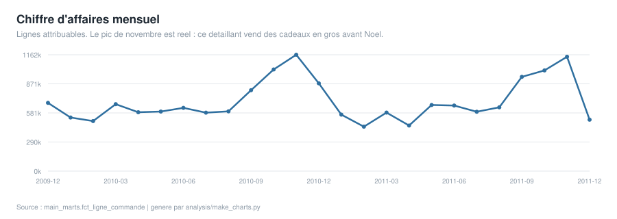
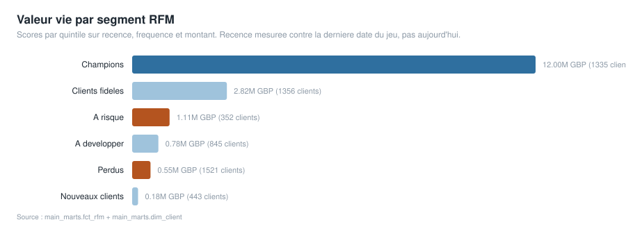
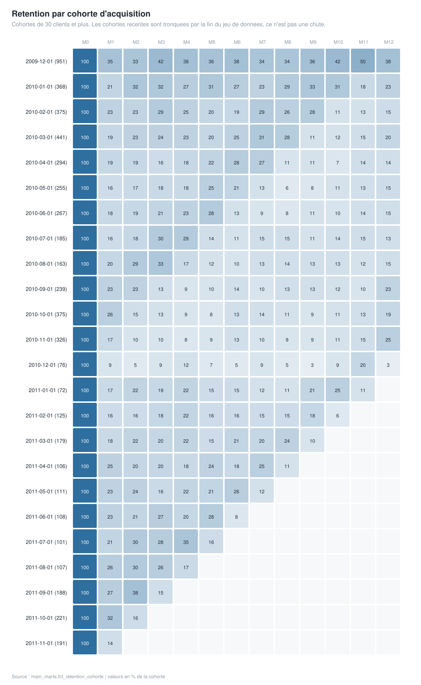

# Where the revenue comes from, and who is worth keeping

A warehouse with a hundred passing tests proves the numbers are trustworthy.
It does not prove anyone picked a useful number. This page is the business
question the warehouse was built to answer, the metric that answers it, and
the decision a merchant could take from it. The models and tests sit
underneath.

---

## The business question

**This is a UK gift wholesaler with 5,852 identified customers and two years
of orders. Retention budget is finite. Which customers should it be spent on,
and when?**

---

## The metric, defined

Two measures carry the answer, and both need their definitions stated before
the numbers mean anything.

**Revenue.** Attributable sale lines only: cancellations removed, non-product
codes such as postage and bank charges removed, zero-price rows removed, and
the ~234,000 lines with no customer ID excluded from anything customer-grained.
That leaves **802,634 of 1,067,371 raw lines** and **GBP 17,434,464.73**.

The gap between those two line counts is not waste, it is the definition. A
quarter of the raw file is not an attributable sale, and quoting one revenue
number for both populations would be wrong in whichever direction you picked.
The unattributed invoices are real money and stay in `fct_commande`; they are
simply not people, so they cannot appear in a per-customer figure.

**RFM segment.** Each customer scored on recency, frequency and monetary
value, then banded. **1,335 of 5,852 customers** score as Champions.

**Cohort retention.** Share of a first-purchase cohort that orders again in
month N. Cohorts under 30 customers are excluded, because a cohort of four can
only ever read 0%, 25%, 50% or 75% and that looks like dramatic movement while
meaning nothing. Later cohorts are truncated by the end of the data; that is
the dataset ending, not customers leaving.

---

## What the data shows

The November peak is real rather than a seasonality weight someone typed in:
this is a wholesaler shipping stock to retailers before Christmas.

---

## The decision a merchant could take

**Proposed. Nobody acted on this; it is what the analysis supports, not
something that was deployed and measured.**

1. **Concentrate retention spend on Champions and the At Risk band.** Champions
   are 23% of identified customers. A gift wholesaler's reorder cycle is
   seasonal, so recency alone misreads a customer who simply has not reached
   their buying window yet; the segment, not the last order date, should drive
   the contact list.

2. **Set the re-engagement trigger from the cohort curve, not from a round
   number.** The month at which repeat ordering falls away is where a
   reactivation offer belongs. Picking "90 days" because it sounds right is
   how budget gets spent on customers who were coming back anyway.

3. **Treat the November peak as a capacity and stock decision, not a marketing
   one.** Demand is already there. Spending acquisition budget into it buys
   customers who would have ordered regardless.

---

## What would test it

None of the above is proven by this data, and the honest version of a
recommendation says how it would be checked.

- Hold back a random slice of the targeted segment from any campaign and
  compare reorder rates. The difference is the only evidence the targeting
  did anything.
- Re-run the cohort curve after the trigger changes, on cohorts formed after
  the change, so the comparison is not contaminated by the old policy.
- Track revenue per customer by segment over time rather than at a point. A
  segment can look valuable because it is large rather than because it is loyal.

---

## Why the plumbing is in the repository

Staging **drops no rows**; it classifies them. Returns, non-product codes,
zero-price rows and unattributed lines are flagged and stay queryable, so the
definition of "a sale" is made once and anyone can ask what was excluded. The
45 tests include a revenue reconciliation that holds source and marts equal to
the penny, which is what lets the figures above be quoted without hedging.

One of those tests exists because of a bug Power BI found and DuckDB could not:
a product key that passed a uniqueness test in the warehouse but broke the
semantic model, because the two engines disagree on string case. Fixed in the
warehouse, with a case-insensitive test added so it cannot return. **170
duplicate product codes merged.**

| | |
|---|---|
| Full technical write-up | [`README.md`](README.md) |
| Models and tests | [`dbt/`](dbt/) |
| Power BI model and report, committed as TMDL/PBIR | [`powerbi/`](powerbi/) |

Data is UCI Online Retail II, 2009-12-01 to 2011-12-09.
