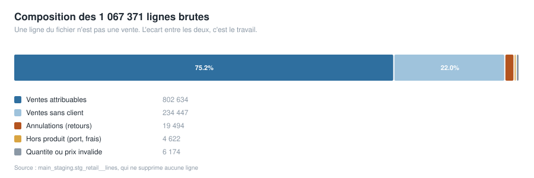
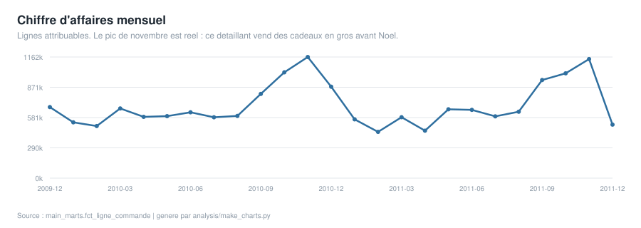
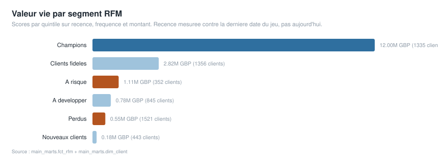
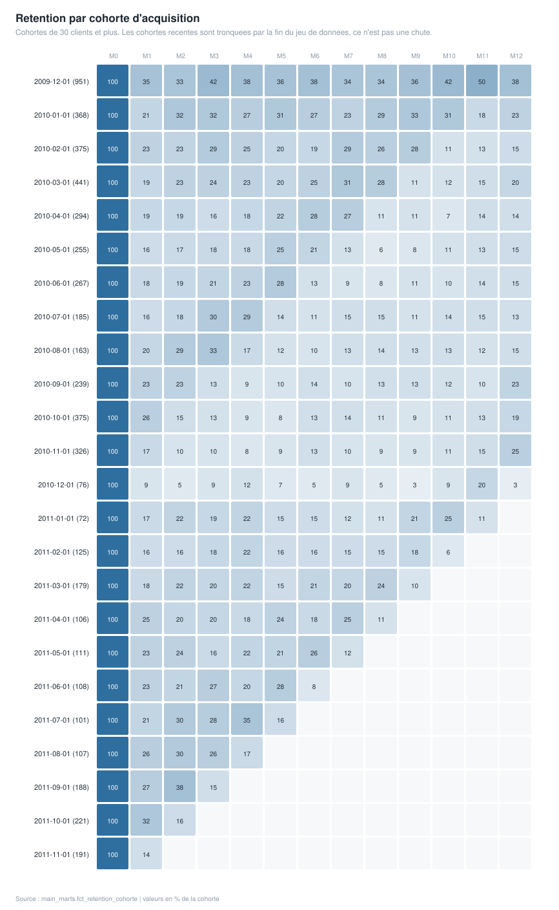

# Retail Analytics Warehouse

An analytics-engineering project on **real** retail data: dbt models over
DuckDB, building a dimensional warehouse with RFM segmentation and cohort
retention, every layer covered by tests that run in CI.

`git clone`, one command to load the data, one command to build. No database
server, no cloud account, no credentials.

## Data

[Online Retail II](https://archive.ics.uci.edu/dataset/502/online+retail+ii)
from the UCI Machine Learning Repository: roughly **1.07 million real invoice
lines** from a UK-based online gift retailer, 01/12/2009 to 09/12/2011. Mostly
wholesale buyers rather than consumers, which is why retention here is far
higher than a consumer shop would show.

The raw file is not committed. `ingest/load_raw.py` fetches it from UCI and
loads it into DuckDB unchanged — a pipeline that cannot re-fetch its own input
is not a pipeline.

## Output

Every chart below is rendered straight from the warehouse by
`analysis/make_charts.py` and committed as SVG. They are not drawn in a tool
and pasted in, so they cannot quietly go stale: re-run the script after a
build and the picture follows the data.

Hand-written SVG rather than matplotlib - no extra dependency to install, the
output is text so git can diff it, and GitHub renders it inline.

### Where the rows go



The chart to read first. A line in the file is not a sale, and the distance
between those two numbers is most of the work on this project.

### Revenue by month



The November peak is real, not a seasonality weight someone typed in: this is
a UK gift wholesaler shipping stock to retailers before Christmas.

### Lifetime value by RFM segment



### Cohort retention



Cohorts under 30 customers are excluded. A cohort of four can only ever show
0%, 25%, 50% or 75%, which looks like dramatic movement on a heatmap and means
nothing. Later cohorts are truncated by the end of the data - that is the
dataset ending, not customers leaving.

## What makes this dataset worth the trouble

It is genuinely messy, and handling the mess correctly is the actual work:

| Reality in the data | How it is handled |
|---|---|
| Returns are encoded as a `C` prefix on the invoice number — there is no returns table | Flagged `est_annulation` in staging, surfaced as `int_retours` with the sign flipped |
| ~25% of rows have no customer ID | Real revenue, so kept in `fct_commande`; excluded from everything customer-grained so they never become a phantom customer |
| `POST`, `BANK CHARGES`, `M`, `D`, test rows share the product code column | Classified `est_hors_produit`; a test fails the build if any reach the product fact table |
| Negative quantities and zero prices occur outside cancellations | Excluded from sales by explicit, separate conditions rather than one catch-all filter |
| The same product appears under several spellings across two years | Most frequent description wins; the count of variants is kept as a column so the messiness stays measurable |

Staging **drops no rows**. It classifies them. Dropping bad rows destroys the
evidence that they existed; every downstream model filters on the flags, so
the definition of "a sale" is made once and anyone can query what was excluded.

## Model graph

```
raw.online_retail  (1.07M lines, untouched)
        │
        └── stg_retail__lines ......... typed + classified, nothing dropped
                 │
                 ├── int_lignes_vente ....... the single definition of "a sale"
                 ├── int_retours ............ cancellations, sign flipped
                 └── int_premiere_commande .. first/last order per customer
                          │
   ┌──────────────────────┼─────────────────────────┐
   │                      │                         │
 dim_date            dim_client               dim_produit
 fct_commande        fct_ligne_commande       fct_rfm
                     fct_retention_cohorte
```

`int_premiere_commande` exists so that `dim_client` and
`fct_retention_cohorte` cannot disagree about when a customer joined. A cohort
that disagrees with the customer dimension is a bug waiting to happen, so the
question is answered in exactly one place.

## Tests

Generic tests on keys, relationships, ranges and accepted values, plus five
singular tests that encode things that must be true of *this* business:

- **`assert_ca_marts_egale_source`** — revenue in the fact table equals revenue
  in staging, to the penny. This is the one that catches a silently dropped
  join. Every other test checks a property; this checks that no money went
  missing between source and mart.
- **`assert_mois_zero_toujours_complet`** — every cohort is 100% retained in its
  own acquisition month. True by construction, so if it fails, the cohort month
  and the activity month disagree — typically a date-truncation bug.
- **`assert_pas_de_retention_avant_acquisition`** — nobody is active before they
  first bought.
- **`assert_clients_rfm_complets`** — every customer gets a score. A customer who
  falls out of the segmentation is invisible to every campaign built on it.
- **`assert_lignes_hors_produit_exclues`** — postage never reaches the product
  fact table. Without it, "top products by revenue" eventually returns POSTAGE.

## Analysis in the warehouse

**RFM segmentation** (`fct_rfm`) — quintile scores on recency, frequency and
monetary value, into six segments. Recency is measured against the last date in
the dataset, not `current_date`: using today would make every customer look
dormant by years, and the segment boundaries would silently shift every time
the model was rebuilt.

**Cohort retention** (`fct_retention_cohorte`) — monthly acquisition cohorts by
months-since-first-order. Later cohorts are truncated by the end of the data;
that is a property of the dataset, not a finding.

## Running it

```bash
pip install -r requirements.txt
python ingest/load_raw.py          # downloads ~45 MB from UCI, loads to DuckDB

cd dbt
dbt deps   --profiles-dir .
dbt build  --profiles-dir .        # runs every model and every test
cd ..

python analysis/make_charts.py     # re-render the README charts from the marts
```

Then query it with anything that speaks DuckDB:

```sql
select segment, count(*) as clients, round(sum(montant)) as valeur
from fct_rfm join dim_client using (client_id)
group by segment order by valeur desc;
```

## Headline figures

Produced by `dbt run-operation print_resume`, which runs in CI on every push,
so these cannot drift away from what the warehouse actually contains.

| Measure | Value |
|---|---|
| Raw invoice lines loaded | 1,067,371 |
| Sale lines, attributable | 802,634 |
| Sale invoices | 39,516 |
| Customers | 5,852 |
| Products | 4,901 |
| Revenue, attributable lines | GBP 17,434,464.73 |
| Invoices with no customer ID | 2,922 |
| Customers scored "Champions" | 1,335 |
| Date range | 2009-12-01 to 2011-12-09 |

Two of those numbers deserve a note rather than a victory lap.

**802,634 of 1,067,371.** A quarter of the raw lines are not attributable
sales: cancellations, non-product codes such as postage and bank charges,
zero-price rows, and the ~234,000 lines with no customer ID. The gap between
the two figures is the work.

**Revenue is attributable only.** The 2,922 unattributed invoices are real
revenue and sit in `fct_commande`; they are excluded from the customer-grained
figure above because they are not people. Quoting one number for both would be
wrong in whichever direction you picked.

## Stack

dbt 1.9 · DuckDB · dbt_utils · GitHub Actions

## Notes

Data is used under the UCI Machine Learning Repository's terms and is not
redistributed here. Figures describe this dataset only and are not a claim
about retail in general.
